# Web interface design review

Status: design note (kittrial-5bb.400). No product code changes. Mock-ups, captures and a proposed
stylesheet delta are under [web-ux/](web-ux/).

## Summary

The interface is complete but hard to read. Most pages put the tools of the rarest reader first and
the thing most readers came for last:

- **The project page** opens with the merge slot, guidance, onboarding and the Lanes board. The
  task list, the page's purpose, starts about 1,400 px down on a 1280x800 screen and 1,640 px
  down on a phone.
- **The task page** is about seven screens tall. It opens with six lifecycle facts shown twice,
  usually all "Unknown". The one sentence a reader needs ("Next: casey delivers") is the sixth
  block. The task's own description starts about 1,000 px down. Machine records are shown as if
  they were comments, and one is rendered as "[object Object]".
- **Records** offers "Review & accept" to the owner on every waiting draft, without saying that
  the project's coordinator accepts them and the owner need not act.
- **Lanes** heads each lane with a raw account id, shows machine words and ISO times, and shows a
  project owner no lanes at all, although its own text says owners see every lane.

The proposal keeps every feature and moves it. Each page gets the same shape:
1. a header;
2. a summary strip that says where things stand and **who acts next, by name**;
3. the page's main content;
4. rare tools and raw records folded below (`<details>`, no script).

It is delivered in five slices; the first changes only the stylesheet (section 5).

**Method.** Every capture comes from a trial of the real web service started on 127.0.0.1 with a
scratch bd, seeded over HTTP with synthetic data (a sample "order portal" project with an owner,
two contributors, a viewer and one agent). No live installation was read. Ids in the captures are
masked in the page text before capture (`usr_…`, `req_…`, `01a1…`). Measurements are from the
trial at main a89790a (1024d); the Lanes panel was captured again after merging main b9b1c12
(1024e), which fixed its authority error.

## 1. Inventory

Who: **O** owner, **C** coordinator (a person or the project's coordinator agent), **W**
contributor (worker), **V** viewer, **A** someone who runs agents. How often: daily, weekly, rare.

| page | route | for | who | how often |
| --- | --- | --- | --- | --- |
| Sign-in, welcome | `/welcome` | sign in, first steps | all | rare |
| My work | `/` | what waits on me, across projects | all | daily |
| My agents | `/agents` | my agents: set up, start, see what each holds | A | daily |
| Agent set-up | `/setup` | prepare an agent's folder | A | rare |
| Projects | `/projects` | pick a project | all | weekly |
| Project (Tasks) | `/p/{pid}` | the task list; plus merge slot, guidance, onboarding, Lanes | all; tools O C | daily |
| New task | `/p/{pid}/new` | create a task | O C W | weekly |
| Task | `/p/{pid}/t/{tid}` | read a task, where it stands, deliver, review, comment | all | daily |
| Reviews | `/p/{pid}/reviews` | proposals and contributions by review state | O C | daily |
| Releases | `/p/{pid}/releases` | record and check release groups | O C | rare |
| Requirements | `/p/{pid}/requirements`, `/{rid}` | the requirement document and its revisions | O C | weekly |
| Records | `/p/{pid}/records` and record pages | references and capabilities: drafts waiting, catalog | C (accepts), all read | weekly |
| Decisions | `/p/{pid}/decisions`, `/{did}` | decision issues | O C | rare |
| Rooms | `/p/{pid}/rooms`, `/{rid}` | discussion threads | all | weekly |
| Feedback | `/p/{pid}/feedback` | feedback on Orchestra itself | all | rare |
| Members & settings | `/p/{pid}/settings` | members, roles, coordination rules, credentials, audit | O | rare |
| Set up | `/p/{pid}/setup` | the project's set-up checklist | O | rare |
| How work is found | `/p/{pid}/how` | reference documentation | all | rare |
| Users (admin) | `/admin/users` | installation accounts | operator | rare |
| Account | `/account` | my password and sessions | all | rare |

Task files are a panel on the task page. Lanes is a panel on the project page today.

## 2. What is hard, page by page

Captures are 640 px wide (desktop at 1024 px, scaled) or 375 px (phone). "Current" is the trial;
"proposed" is the static mock-up of the same synthetic data.

### 2.1 Project page

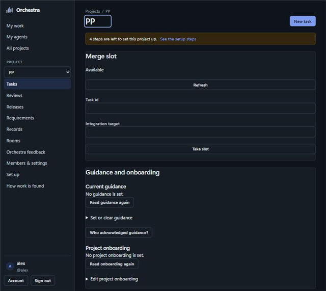

**Current order** (owner, 1280 wide, 2,100 px tall, 302 words, 16 buttons, 8 inputs):
```
h1 "PP"                                  [New task]
banner  4 steps are left to set this project up
Merge slot        Available / Refresh / Task id / Integration target / [Take slot]
Guidance and onboarding   h3 Current guidance … h3 Project onboarding …
Lanes             prose, threshold, table (an error before 1024e)
"Want the product to do something? Propose a requirement on Reviews"
[Active|Closed|All] [Any review state]  [ ] Show requirements
null
Tasks in PP  (TASK STATE ASSIGNEE NEXT-ACTION UPDATED)   <- the page's purpose
null
pager
```
- The task list starts about 1,400 px down; on a phone, 1,640 px down.
- Two literal "null" strings (an unguarded value).
- Before 1024e an error panel showed a request id to every reader.
- "Next action" repeats "Claim this task" on every unclaimed row.
- The project's description is not shown; the name is the id ("PP").

**Proposed** ([mock-up](web-ux/project.html)):

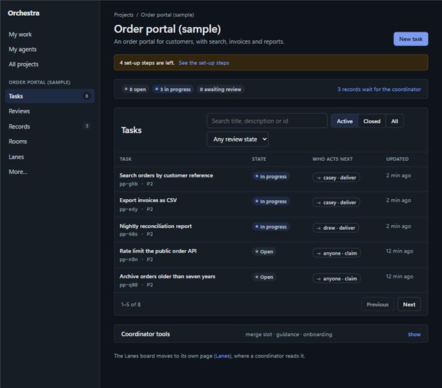
```
h1 Order portal (sample)  lede: description            [New task]
banner (set-up steps, only while any are left)
summary  [8 open][3 in progress][0 awaiting review]   "3 records wait for the coordinator"
Tasks    search · Active|Closed|All · review state
         TASK (title, id·P2) | STATE | WHO ACTS NEXT ("casey · deliver") | UPDATED
details  Coordinator tools: merge slot · guidance · onboarding   (closed)
Lanes moves to its own page
```

### 2.2 Task page

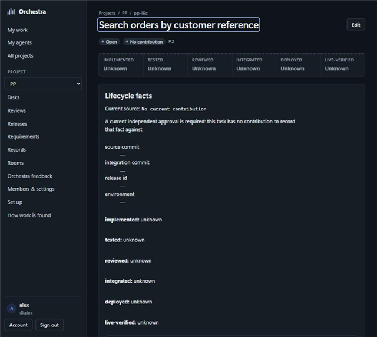

**Current order** (owner, 1024 wide, 5,558 px tall, 641 words, 13 buttons, 29 inputs):
```
breadcrumb; h1 [Edit]; badges Open · No contribution · P2
six lifecycle facts in capitals, all "Unknown"
Lifecycle facts h2: paragraph; four "—" values; the six facts again as lines; Refresh; 2 details
"Next: Deliver a contribution — waiting on casey."     <- the sentence a reader needs, 6th block
Assign task form
Brief: the description (about 1,000 px down), Where it stands, Changes since, Unresolved items
Contribution & review
Add a comment (form)
Record a checkpoint (form, 12 fields, always open)
History
task metadata (status, priority, assignee, created, updated, id)
Files
```
- "Checkpoint 3 minutes ago by **[object Object]**": an object rendered as text.
- A stale checkpoint's next step reads as internal jargon ("STALE CHECKPOINT: activity the
  checkpoint did not incorporate exists (1 by other actors, 0 own; … coverage TIMESTAMP …)").
- "Changes since this checkpoint" and History print machine records
  (`Kind: task-assignment-v1 {json}`, `Kind: task-checkpoint-v1 {json}`) with account ids,
  activity cursors and operation ids, as if they were comments.
- The description is shown as raw Markdown ("## Goal").
- **At 375 px** the page was 1,026 px wide on the first trial, so the whole page scrolled
  sideways: a 64-hex operation id in a printed machine record does not wrap. On the second trial
  (no such record in the Brief) it fits. Either way the Brief starts at 1,918 px.

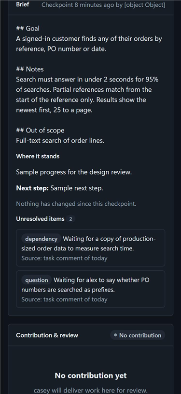

**Proposed** ([mock-up](web-ux/task.html)):

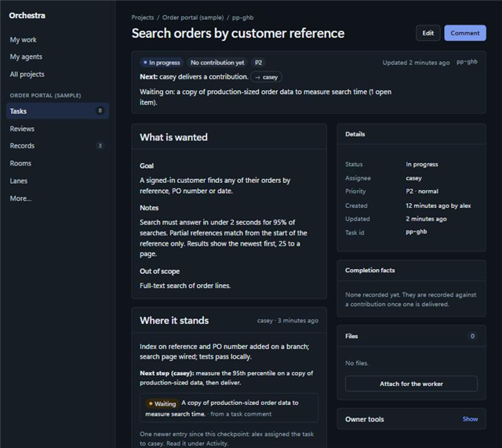
```
breadcrumb; h1                                         [Edit] [Comment]
summary  In progress · No contribution yet · P2      Updated 2 min ago · pp-ghb
         Next: casey delivers a contribution. (-> casey)
         Waiting on: production-sized data (1 open item)
main column                          | side column
  What is wanted (description, md)   |   Details (status, assignee, priority, dates, id)
  Where it stands (checkpoint, by    |   Completion facts (one line until any is known)
    name, open items as notices)     |   Files
  Contribution & review              |   details Owner tools (assign, lifecycle evidence)
  Activity: comments; records as one-line events, raw JSON folded
  details Record a checkpoint (closed)
```
At 375 px the side column follows the main column; nothing scrolls sideways
([phone capture](web-ux/img/proposed-task-phone.png)).

### 2.3 Records (full depth, as the plan's condition asks)

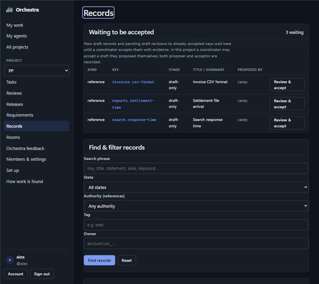

**Current order** (owner, 3,312 px, 273 words, 4 buttons, 26 inputs):
```
Waiting to be accepted (3)  paragraph; KIND KEY STAGE TITLE PROPOSED-BY [Review & accept] per row
Find & filter records (5 fields)
Reference catalog (the same three drafts again)
Propose a reference record (form, 11 fields, always open)
Capability registry (0 shown)
Propose a capability record (form, 10 fields, always open)
```
- **Who acts is not said.** The first thing on the page is a to-do list with "Review & accept" on
  every row. The paragraph says "until a coordinator accepts them", but not who the coordinator
  is in this project (often its coordinator agent) or that the owner need not act. An owner
  reads it as their own queue.
- The same drafts appear twice (waiting, then catalog).
- The authority column shows "—" for attested drafts, although the attestation is there.
- Two long propose forms are always open; proposing is rare and mostly done by agents.

**Proposed** ([mock-up](web-ux/records.html)):

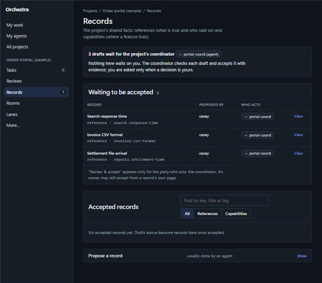
```
h1 Records  lede: references (what is true, who said so) and capabilities (where a feature lives)
summary  "3 drafts wait for the project's coordinator (-> portal-coord, agent).
          Nothing here waits on you; you are asked only when a decision is yours."
Waiting to be accepted (3)   RECORD | PROPOSED BY | WHO ACTS (-> portal-coord) | View
          "Review & accept" only for the party who acts; an owner can still accept on the record page
Accepted records   search · All|References|Capabilities
details  Propose a record (usually done by an agent)
```
Who acts is read from the project's coordination settings (the same source as the Members &
settings "Who coordinates" section), not inferred in the page. When the coordinator is an agent,
whether that agent may accept is kittrial-5bb.401's gap G1; the page shows what the server
allows and never offers a button the server will refuse.

### 2.4 Lanes (full depth)

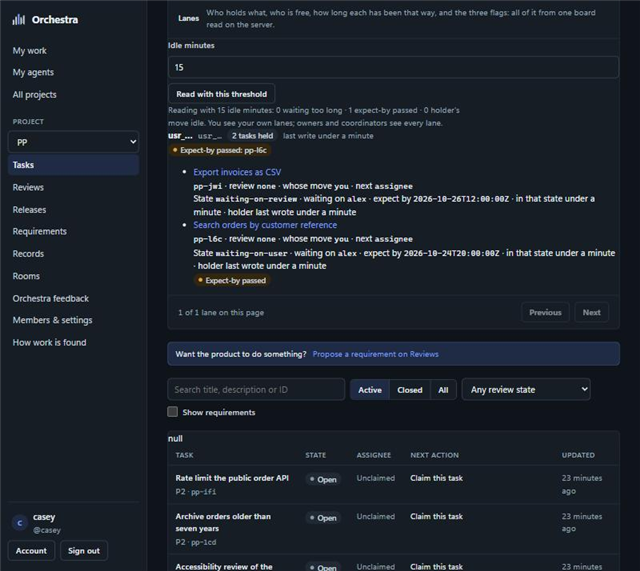

After 1024e the panel loads. Seeded with declared lane states (casey holds two tasks, one waiting
on alex with a passed expect-by; drew holds one, working):
- **The lane is headed by the raw account id, twice** ("usr_… usr_…"), not the person's name.
- **Machine words:** "review none · whose move you · next assignee"; the state as
  "waiting-on-review".
- **Raw times:** expect-by as "2026-10-26T12:00:00Z".
- **Contradiction:** "whose move: you" on a lane that declares it is waiting on alex. Both are
  right by their own rules (the computed move is the holder's; the declared state is the lane's
  claim), but the page shows them side by side without saying which to believe.
- **Good:** the expect-by flag is shown on the lane and on the row; the threshold is an argument;
  each task links to its page.

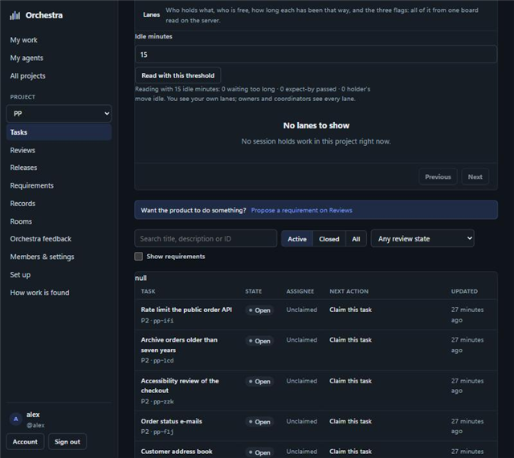

- **The project owner sees no lanes.** The panel says "owners and coordinators see every lane",
  but the route (`_lanes_scope`, http_service.py) counts only an installation operator
  (`review_workflow.listed_operator_actor`) as an owner. A project owner on the web reads scope
  `own` and gets "No lanes to show" while two people hold three tasks. Either the sentence or the
  rule is wrong; this is a product decision (section 6), not a layout one.

**Proposed** ([mock-up](web-ux/lanes.html)): its own page under the project, for the coordinator.

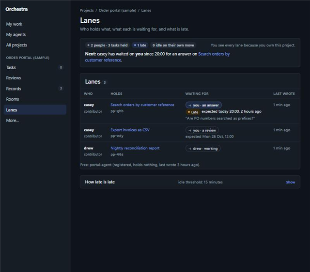
```
h1 Lanes   lede: who holds what, what each is waiting for, and what is late
summary  [2 people · 3 tasks held] [1 late] [0 idle on their own move]
         "You see every lane because you own this project."   <- states the scope rule in force
         Next: casey has waited on you since 20:00 for an answer on <task>.
Lanes    WHO (name, role) | HOLDS (task, id) | WAITING FOR (-> you · an answer; Late, expected
         today 20:00, 2 hours ago; the open question) | LAST WROTE
         Free: portal-agent (registered, holds nothing, last wrote 3 hours ago)
details  How late is late (idle threshold, with what each flag means)
```
The declared state leads ("waiting for you · an answer"); the computed move is not shown
separately when it only restates that the holder is the assignee.

### 2.5 My work and My agents

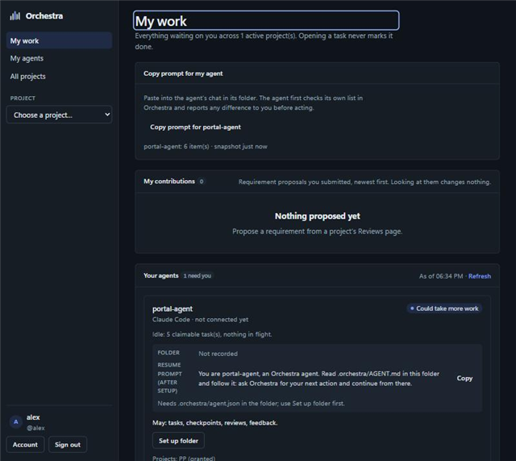

- **My work** repeats the full agent card from My agents ("Your agents"), and shows three empty
  sections ("Revisions requested", "Waiting for your review", "Assigned to you") even when
  nothing waits.
- **My agents:** one dense card per agent (connection, "Idle: 5 claimable task(s)", folder, the
  resume prompt with Copy, scopes, "Set up folder", five folded settings). It is folded well, but
  the next step for the person is not stated, and "claimable" and "resume prompt (after setup)"
  are jargon.

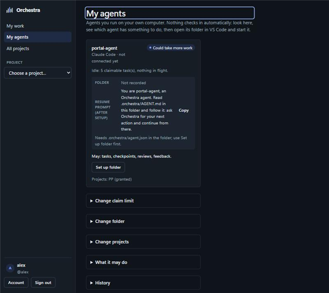

**Proposed** ([mock-up](web-ux/agents.html)): a card that says the next step and who takes it
("Next: set up its folder, then start it. -> you"), with the resume prompt and settings folded.
My work shows one line per agent that needs its owner and omits empty sections.

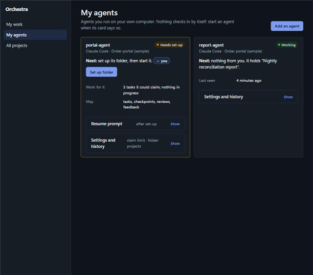

### 2.6 Rooms

The room page is short and readable: numbered messages with author, role and time. Moderation is
by typing a message number into a form. **Proposed** ([mock-up](web-ux/room.html)): a "Moderate"
fold on each message, and room tools (archive) folded below the post form.

### 2.7 The other pages (short proposals)

| page | what is hard | proposal |
| --- | --- | --- |
| Reviews | every empty group shows its prose and an empty state | one line per empty group; groups with items first |
| Requirements | explanations come before the (empty) document | document first; the explanation folded |
| Releases | an 8-field "Record one release group" form is always open | form folded; the release list first |
| Members & settings | 3,071 px, a 21-row audit table always open | audit and credentials folded; members and "who coordinates" first |
| Set up | done steps are as long as open ones | done steps collapse to one line |
| How work is found | 11,980 px, 6,423 words, no table of contents | an on-page contents list (`.on-page`) and folded sections |
| Projects | the "New project" prose explains admin.py to people who cannot run it | say who can create a project; the command only for operators |
| New task, sign-in, account | compact | no change |

Across pages: the h1 takes focus on navigation (right for screen readers) and draws a focus ring
that looks like an edit box. Show the ring only for keyboard focus (`:focus-visible`).

## 3. Shared components

All in [web-ux/proposed.css](web-ux/proposed.css), a delta on app.css that uses only app.css's
tokens:

| component | class | use |
| --- | --- | --- |
| summary strip | `.summary` with `.chips`, `.next`, `.meta` | where things stand and who acts next, at the top of every page |
| who acts | `.who-acts` (`.you`, `.agent`) | the party a row or step waits on, always by name, never by id |
| fold | `details.fold` | rare tools, raw records, long forms; closed by default, no script |
| tools grid | `.tools` | coordinator and owner tools inside a fold |
| record event | `.record-event` | a machine record as one line, raw JSON folded |
| empty line | `.empty-line` | one line instead of an empty-state block |
| count | `.count` | numbers in section heads |
| on-page contents | `.on-page` | long pages |
| phone table | `table.stack-narrow`, `td.full-narrow` | tables that become two-column rows under 760 px |

Long identifiers wrap everywhere (`overflow-wrap: anywhere` on panels, cards and cells), which
alone removes the task page's sideways scroll.

## 4. Rules that must hold

- **Untrusted text stays text.** Every value from the server goes through dom.js
  (`textContent`) or md.js's escaped subset. The mock-ups contain no user HTML, and the proposals
  add no `innerHTML`.
- **No external assets, no framework.** No fonts, images or scripts fetched; plain ES modules as
  today. The mock-ups load only app.css and proposed.css.
- **No new authority in the page.** Who acts is read from the server (coordination settings, the
  lanes read's scope). A button appears only where the server would accept the action.
- **Accessibility.**
  - One h1 per page; landmarks (`nav`, `main`); every control labelled.
  - Keyboard only: `<details>`/`<summary>` are native and focusable; focus stays visible
    (`:focus-visible`).
  - Contrast at least 4.5:1: the proposal adds no colours, only app.css's tokens, whose text pairs
    already meet it.
  - Meaning is never carried by colour alone: "Late" is a word on the chip, not only amber.
  - No animation is added, so `prefers-reduced-motion` needs nothing new.
- **Phone width.** Nothing scrolls sideways at 375 px; tables stack.

## 5. Slices (five, each deliverable alone)

How the web tests pin the pages today, which decides what each slice may move:
- Node-backed tests render views through a small fake DOM (tests/web_dom_shim.mjs, no CSS or
  layout) by importing named exports (`detail`, `overview`, `lanesPanel`, `checkpointForm`,
  `page`, `referencePage`) and asserting on text, `data-*` attributes and some exact parent
  classes.
- Many other tests read a view's source and assert that an exact code line is present, or that
  one call comes before another.
- No test reads app.css's content; test_http_web pins only its media type and that the page has
  no inline script or style.

1. **The stylesheet only.** Move proposed.css into app.css (summary strip, who acts, folds,
   record events, empty line, count, on-page contents, phone tables, `overflow-wrap` on long
   ids, `:focus-visible` on the h1). No view changes.
   - **test_http_web's pinned facts stay green:** `test_scripts_styles_and_views_have_exact_media_types`
     and `test_ui_needs_no_inline_script_or_style` are untouched, and no test reads app.css. No
     test is updated.
   - Alone it removes the task page's sideways scroll at 375 px and the h1's edit-box ring.
2. **The task page.** The summary strip with "Next" and who acts at the top; the description as
   "What is wanted" (rendered by md.js); the side column; lifecycle facts as one line until one is
   known, with the evidence form under Owner tools; the checkpoint form folded; machine records as
   one-line events with the raw JSON folded; "[object Object]" fixed (the author's name).
   - Keeps the exports `detail`, `checkpointForm`, `commentForm`, `reviewActions`,
     `assignmentForm`, `contextPointers`, and the panels in their own modules (lifecycle.js,
     taskFiles.js).
   - **Tests it updates, named:** web_brief_open_items.mjs and web_changes_since_checkpoint.mjs
     (the exact parent classes `timeline`, `open-items`, `changes-entries`, `changes-fields`, if
     the history entries become events); the source pins in test_http_web.py
     (`test_the_task_page_offers_the_respond_step`), test_http_recommendations.py,
     test_web_task_files.py and test_http_project_register.py only where a pinned line moves.
3. **The project page and Lanes.** The task list first, with "who acts next" by name; the stray
   "null"s fixed; merge slot, guidance and onboarding in a "Coordinator tools" fold; Lanes moved to
   its own route (`['lanes', '/p/{pid}/lanes']`) with names, plain states and local times, and the
   scope it was read with stated on the page.
   - **Tests it updates, named:** test_web_lanes.py's
     `test_the_panel_renders_the_read_and_re_reads_with_a_new_threshold` (it asserts the overview
     contains `data-panel="lanes"`; it would assert the Lanes page instead, keeping
     `#lanes-idle-minutes`, `data-lane` and `data-flag`); test_http_project_register.py's order pin
     (`project.usable === false` before `'New task'` in `overview`), kept true or updated.
   - Keeps routes.js's `['name', '/path']` form (test_http_web.py and test_finding_work.py pin it).
   - The scope rule itself is decision 1 (section 6), not this slice.
4. **Records.** The summary that names who acts on waiting drafts; "Review & accept" only for the
   party who acts; one list (waiting, then accepted) instead of two; the propose forms folded; the
   authority cell showing an attestation.
   - test_web_records.py's `test_records_view_dom_flows` pins "Waiting to be accepted", the
     "2 waiting" badge, the pending-revision texts and the `data-accept-reference-form` and
     `data-verify-capability-form` forms. The slice keeps them; nothing asserts on the propose
     forms.
5. **My work, My agents, rooms and the rest.** The agent card with its next step; My work with one
   line per agent that needs its owner and no empty sections; room moderation on each message;
   the short proposals of section 2.7.
   - **Tests it updates, named:** test_http_proposals.py's order pin in work.js's `home`
     (`agentPromptPanel(ctx, data)` before `contributions,` before `agentsPanel,`), if the agent
     card leaves My work. Keeps `DIV[data-agent]` with the name as its first `H3`, the
     `'What it may do (choose)'` summary, and the agentCard source lines test_http_web.py pins.

Each slice is checked with the web tests (node-backed ones on Windows with `PYTHONUTF8=1`), a
capture at 1024 and 375 px against the matching mock-up, and a keyboard-only pass.

## 6. Decisions this note needs

1. **Who sees every lane.** Either the Lanes text changes to "operators see every lane", or the
   route's rule widens to the project's owners and coordinators (an authority change, with its own
   review). The proposed page states whichever rule is in force.
2. **Who accepts records, shown on the page.** The page names the acceptor from the project's
   coordination settings. Whether a coordinator agent may accept is kittrial-5bb.401's G1.
3. **Lanes on its own page.** The proposal moves the board off the project page to a Lanes page
   in the project menu.
